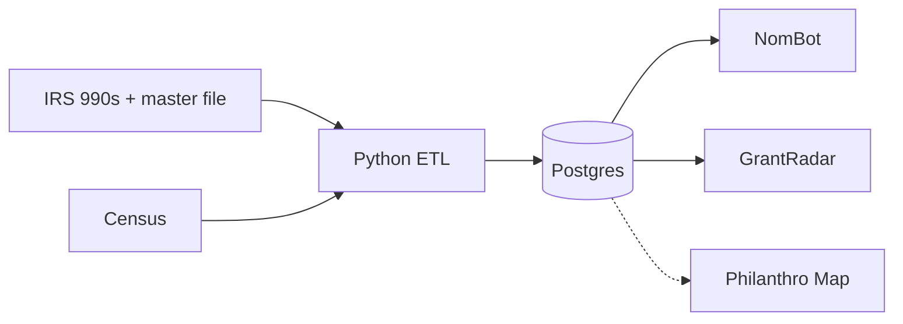
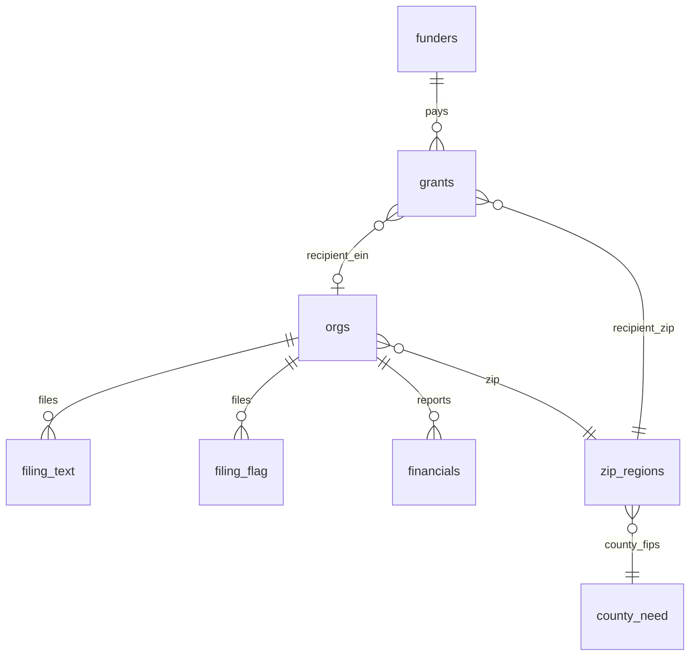
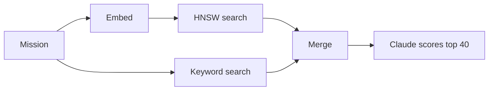

# generosity-data

Shared IRS nonprofit data pipeline and Postgres + pgvector schema for [NomBot](https://github.com/institute-on-generosity/NomBot) and [GrantRadar](https://github.com/institute-on-generosity/GrantRadar).

**Brief:** [read it below](#brief-one-database-for-our-990-projects): what's loaded, what's left out, data sources, the cloud plan and insights (Oct 14 meeting with Philanthro Map). Interactive version: [`docs/shared-database-brief.html`](docs/shared-database-brief.html).

**Data sources:** [`docs/data-sources.md`](docs/data-sources.md): every source, connected or coming, by what it brings, with API links.

**Health:** [`docs/db-health.md`](docs/db-health.md): checks, counts, freshness and table sizes; regenerate with `python3 etl/db_health.py` after a load.

**Graph view:** [`docs/board-interlocks/`](docs/board-interlocks/): orgs that share board members, by state. Build its data with `python3 etl/export_interlocks.py` (git-ignored: it lists board members' names), then `python3 -m http.server -d docs/board-interlocks`.

## Brief: one database for our 990 projects

Written for the Oct 14, 2026 meeting with Tyler (Philanthro Map), kept current. Same content as an interactive page: [`docs/shared-database-brief.html`](docs/shared-database-brief.html) (download and open in a browser) or the [claude.ai brief](https://claude.ai/artifact/C9ijG2YA29zEoDEM9rs4Bf) (shared on request).

| nonprofits | 990 returns | foundations | grants · 4 IRS years · $392B | counties | database |
|---|---|---|---|---|---|
| **1.97M** | **785,772** | **138,734** | **5.35M** | **3,144** | **14 GB** |

- **Largest:** 990 text + vectors 7 GB, grants 2 GB, board members 1.5 GB, orgs 1.1 GB.
- **Raw IRS files:** 58 GB (14 GB zips + 44 GB unzipped). Not stored. Re-downloadable.
- **Why smaller:** we keep ~40 of ~440 values per 990, as numbers without XML tags.

<details><summary><b>Database</b>: how data flows, what we keep and leave out, tables, vector search, limits</summary>

### How data flows



- **ETL:** scripts that download, clean and load public files. One per source, in [etl/](https://github.com/institute-on-generosity/generosity-data/tree/main/etl).
- **Plain Python + psql.** Re-runs update rows, never duplicate.
- **Runs** by hand. Monthly on GitHub Actions after the cloud move.

### What we keep from a 990

A typical 990 fills in **~440** values (median of 254 filings; 990-EZ ~160, 990-PF ~400). We keep about 40.

| We keep | Part |
|---|---|
| **990 · ~40 fields** | |
| Mission, programs | I, III |
| Staff, volunteers, website | I |
| Revenue, expenses, gifts, pay (2 years) | I |
| Government grants | VIII |
| Cash, assets, debts | X |
| Program, admin, fundraising spend | IX |
| Board, policies, audit | VI, XII |
| Insider deals | IV |
| Officers and pay | VII |
| **990-PF · ~20 fields** | |
| Assets, total giving | I |
| Invite only, how to apply | XV 2 |
| Each grant: who, amount, purpose | XV 3a |

### What we leave out

★ = worth adding next

| Part | Not loaded |
|---|---|
| **990** | |
| III | Dollars per program |
| V | W-2 and 1099 counts, foreign accounts |
| VII B | Contractors over $100K |
| VIII | Revenue by source★ |
| IX | 24 expense lines (rent, travel, IT)★ |
| X | Balance sheet detail |
| XII | Accounting method |
| Sch. A | Charity type, public support test |
| Sch. B | Donors (blanked in public copies) |
| Sch. C | Lobbying, political spending |
| Sch. D | Endowments, donor advised funds★ |
| Sch. F | Work abroad |
| Sch. G | Fundraising events |
| Sch. H | Hospital community benefit |
| Sch. I | Grants by community foundations, DAF sponsors★ |
| Sch. J | Executive pay detail |
| Sch. L | Insider deals, itemized |
| Sch. M | Gifts of property, stock |
| Sch. O | Free-text explanations |
| Sch. R | Related orgs |
| **990-PF** | |
| I | Revenue and expense lines |
| II | Investments |
| Officers | Officers and pay |
| XV 3b | Grants approved, not yet paid★ |
| Activities | Program-related investments |

### Tables



| Table | Holds |
|---|---|
| `orgs` | Every nonprofit: address, cause, revenue |
| `financials` | Revenue, expenses, assets by year |
| `filing_text` | Mission, programs, staff, website |
| `filing_flag` | Cash, debts, spending, board, pay |
| `funders` | Foundations: assets, how to apply |
| `grants` | Each grant: recipient, ZIP, amount, purpose |
| `zip_regions` | ZIP → county, Appalachia |
| `county_need` | Poverty, income, population |

### Vector search



- **Embedded:** mission + programs, 785,772 filings.
- **Model:** nomic-embed-text-v1.5, local, 512 dimensions. Cloud: OpenAI text-embedding-3-small.
- **Index:** HNSW cosine on `filing_latest`, the newest filing per org.
- **Model switch:** re-embeds only stale rows, via `embedding_model`.
- **GrantRadar:** mission → 150 closest grantees → their funders.

### For Philanthro Map

**90% of grants map to a county:** `grants.recipient_zip → zip_regions → county_need`.

- **3,196** counties receive grants.
- **52%** of grants stay in the funder's state.

### Limits

- **Text:** only orgs that e-file a 990 (541,879 of 1.97M).
- **Years:** IRS 2023 to 2026 (tax years mostly 2022 to 2025).
- **Recipients:** no EIN on grants. 64% matched (name rules, then Claude for the largest leftovers and to fix wrong links).
- **Individuals:** not on any 990.

### Decide

1. Schema changes: migration + PR?
2. More years: before or after Supabase?
3. Until then: local copy or my dump?
4. What data is the map missing?
5. One county map and color scale for both apps?

</details>

<details><summary><b>Data sources</b>: connected, coming, keeping it fresh</summary>

Every source by what it brings, with API links and status: [`docs/data-sources.md`](docs/data-sources.md).

### Keeping it fresh

| How | Sources | When |
|---|---|---|
| **Nightly check** | IRS 990s, master file, Pub 78, revocations, Census | Every night, 2 AM |
| **Frequent poll** | FEMA hourly. USAspending, Grants.gov daily | Asks only for records changed since last time |
| **Instant write** | Claimed profiles, feedback, saved lists | The app writes straight to Supabase |
| **Fetch on open** | ProPublica org detail | When a page opens, cached 1 day |

**Nightly check:** Ask: anything new? → Load only the new records → Embed and link them → Publish all at once → Apps show it by morning.

</details>

<details><summary><b>Cloud plan</b>: now, next, ultimate; stages; how big; where embeddings run</summary>

### Now, next, ultimate

| | **Now**: Local only, $0 | **Next**: Cloud migration, ~$60 to $110 a month | **Ultimate**: Own workstation + cloud, ~$150 a month + workstation |
|---|---|---|---|
| **ETL** | Python on your Mac, by hand | GitHub Actions, monthly | Always-on workstation, nightly. More sources (Schedule I, more years) |
| **Embed** | nomic. Filings on the Mac GPU, questions in the app | Embedding API (OpenAI or Voyage) for filings and questions | Best open model from the eval. Bulk on the workstation GPU, questions on a small hosted copy of the same model |
| **Store** | Postgres on your Mac | Supabase Postgres + pgvector | Supabase + a read-only replica for the map and partners. Staging copy on the workstation |
| **Serve** | Dev servers at localhost | Vercel: NomBot, GrantRadar, public API | Vercel, with a preview site for every change |
| **Access** | Only you | Public apps and API. Map reads with a read-only role | API keys for partners, with usage limits |
| **Backups** | None | Supabase, daily | Point-in-time restore. Raw IRS archive on the workstation |

### Moving to the cloud

1. **Get** (GitHub Actions, monthly): Download public files. Uses: Raw IRS files, Census files.
2. **Clean + load** (GitHub Actions, monthly. Tested on your Mac first): Pull ~40 fields from each return into rows. Uses: ETL scripts, Postgres staging.
3. **Embed** (OpenAI or Voyage servers, not ours): Turn each mission into 512 numbers. The ETL sends filings, the apps send questions. Uses: Embedding API.
4. **Store** (Supabase): One shared database: tables and vectors together. Every app reads it. Uses: Postgres + pgvector, Auth, Daily backups.
5. **Serve** (Vercel): Apps and API answer searches. Uses: NomBot, GrantRadar, Public API /api/v1/search, Claude API.
6. **Use**: People and partner apps. Uses: Donors, nonprofits, developers, Philanthro Map.

- **APIs:** only `/api/v1/search` is public (rate-limited). The database is never public.
- **Stay small:** vectors for the newest filing per org only. `halfvec` halves their size.
- **Cost:** Supabase with 4 to 8 GB of memory, ~$60 to $110 a month. ETL on GitHub Actions, free.

#### How big it gets

|   | Today | Worst case |
|---|---|---|
| Vectors | 786K | ~2M (every org) |
| Vector index | 1.4 GB | ~3 GB (`halfvec`) |
| Database | 14 GB | ~30 GB (10 IRS years) |

#### Where the embedding model runs

| Option | Cost | Catch |
|---|---|---|
| Embedding API (OpenAI, Voyage) ✓ | Pennies a month | Re-embed filings once, ~$3 |
| Host nomic (Modal, Hugging Face) | ~$5 to $50 a month | One more service to run |
| nomic inside the Vercel app | Free | 550 MB model, slow first searches |
| Supabase built-in (gte-small) | Free | Weaker, 384 dims, schema change |
| Your Mac | Free | Must stay on and online 24/7 |

#### Steps

1. Pick the embedding model (eval: nomic, OpenAI 3-small, Voyage 3.5-lite)
2. Newest filing only, `halfvec`
3. Supabase up, load from local
4. Point the apps at Supabase
5. Monthly ETL on GitHub Actions

</details>

<details><summary><b>Insights</b>: finding hidden patterns, what's missing, build order, tools</summary>

### Finding hidden patterns

| Ready | What we have |
|---|---|
| Meaning | Mission vectors find similar orgs in different words |
| Money | 5.35M grants, funder to grantee, 4 IRS years |
| Place | Orgs and grants on counties, joined to Census need |
| People | 4.86M board seats at 679K orgs. Interlocks built (see below) |
| Time | 225K orgs with 2+ years of filings |

### What's missing

| Gap | Why it blocks discovery | Fix |
|---|---|---|
| Weak links | 36% of grants unlinked. New sources use other IDs (UEI) or only names | ID crosswalk: EIN, UEI, name, address |
| Hidden relationships | Who's connected to whom is buried in JSON and grant rows | Connections table: funds, shares a board member, related org, co-funded |
| One kind of vector | Can't find funders by what they actually fund | Embed grant purposes and funder profiles |
| Thin history | Trends need many years. Search keeps the newest only | Every year as a time series. Add IRS 2021 to 2022 |
| No analytics layer | The model can't read 14 GB. App queries are tuned for lookups | Nightly signal tables. Read-only SQL tool for the model |
| Trust per fact | Name-matched links can be wrong | Source and confidence on every link |

### Patterns it could surface

- **Board interlocks:** the same people on a funder's board and a grantee's.
- **Funding deserts:** high-need counties with few grants and few active nonprofits.
- **Co-funding clusters:** foundations that fund the same groups, so likely next funders for a peer.
- **Early warnings:** falling revenue, a lost federal award and news of layoffs, together.
- **Rising orgs:** fast growth, new funders and new programs in the same year.

### Build order

1. **Connections table** (Board interlocks done, Oct 14): Board interlocks from officer names: 977K same-state pairs, 45K high-confidence hidden links, 13,164 foundations paying an org they share board members with. [Graph view](https://claude.ai/artifact/8u9Nfum4wGRhAZhHJZF2VA). Co-funding next.
2. **ID crosswalk**: Before USAspending and other new sources, so they link on day one.
3. **Grant-purpose vectors** (Embedding API): Search funders by what they fund, not only by who they funded.
4. **Signal tables** (Nightly): Deserts, clusters, trends, warnings, precomputed.
5. **Model tools**: Read-only SQL over the signal tables, so the model asks its own questions.
6. **LLM wiki** (Model-written, on top of the database): Linked pages for hubs (top ~2K funders, causes, states, notable counties), each pattern found, and the Giving Guides. Each page cites its query or source. Research Buddy reads the wiki first, SQL for exact numbers.

### Tools that help

| Tool | Use |
|---|---|
| **Link the same org across sources** | |
| [Splink](https://moj-analytical-services.github.io/splink/) ★ | Matches on name, address and city together, with a confidence score. Millions of rows on a laptop. Tried on grant recipients Oct 15: 57–73% right, not used |
| [Claude Batch API](https://docs.anthropic.com/en/docs/build-with-claude/batch-processing) | Settles hard leftover matches by reading both records, at half price |
| **Find connections** | |
| [igraph / NetworkX](https://igraph.org) ★ | Clusters of funders, hidden hubs, likely next funders. Nightly, results back to Postgres |
| [Neo4j Graph Data Science](https://neo4j.com/docs/graph-data-science/current/) | Same algorithms at larger scale, as a separate service |
| [Apache AGE](https://age.apache.org) | Graph queries inside Postgres. Fewer parts, fewer algorithms |
| [Microsoft GraphRAG](https://github.com/microsoft/graphrag) | An entity graph built from text: guides, websites, news |
| **Find themes the IRS codes miss** | |
| [BERTopic](https://maartengr.github.io/BERTopic/) ★ | Natural cause clusters from our vectors, and how they change over time |
| [scikit-learn](https://scikit-learn.org) | Unusual jumps or drops, for early warnings and rising orgs |
| **Let the model explore safely** | |
| [Postgres / Supabase MCP, read-only](https://supabase.com/docs/guides/getting-started/mcp) ★ | Claude runs its own SQL and can't change data |
| [dbt](https://docs.getdbt.com) ★ | Signal tables as tested, documented SQL, so the model reads clear definitions |
| [DuckDB](https://duckdb.org) | Fast heavy analysis on a copy of the data, free, on the Mac |
| **Keep it trustworthy** | |
| [dbt tests / Great Expectations](https://greatexpectations.io) | Catch bad loads: missing years, sudden zeros, duplicate links |
| [Dagster](https://dagster.io) | Pipelines with lineage and freshness checks, if GitHub Actions gets too small |
| **See the patterns** | |
| [Cosmograph](https://cosmograph.app) | Millions of graph links, interactive in a browser |
| [Kepler.gl](https://kepler.gl) | Large maps, such as grants flowing between counties |

★ Top 5, in order: Splink, graph algorithms, dbt, read-only MCP, BERTopic.

</details>

## Local setup (proof of concept)

```bash
brew install postgresql@17 pgvector && brew services start postgresql@17
export PATH=/opt/homebrew/opt/postgresql@17/bin:$PATH
createdb nombot
db/migrate.sh                     # apply db/migrations/*.sql once each
etl/load_bmf.sh                   # IRS BMF for WV, KY, TN, VA, OH (~205K orgs, ~10s)
STATES="ca ny" etl/load_bmf.sh    # any other states; safe to re-run (upsert)
STATES=all etl/load_bmf.sh        # every state, DC and Puerto Rico (~1.97M orgs)
python3 etl/load_soi.py 24        # SOI 2024 financials for loaded orgs (~8s)
python3 etl/load_regions.py       # ZIP -> county + Appalachia (ARC) flag (~6s)
etl/fetch_990_xml.sh              # every 2025 XML batch, extract filings of loaded orgs (national: 513,813)
python3 etl/load_990_text.py      # mission + program text into filing_text (~8s)
python3 etl/load_990_flag.py      # FLAG diligence fields into filing_flag (~1 min)
python3 etl/load_county_need.py   # county poverty, income, population (Census SAIPE + estimates; no API key, ~5s)
cd embed && npm install && node embed.mjs   # 512-dim embeddings; local fallback if no OPENAI_API_KEY (CPU, ~7 rows/s)
.venv/bin/python embed/embed_gpu.py         # same local vectors on the Mac's GPU (national: ~2 h; setup in the file)
for y in 2025 2024 2023; do YEAR=$y TYPES=990PF etl/fetch_990_xml.sh; done  # every US foundation's 990-PF, 3 years (~13 GB of zips)
python3 etl/load_grants.py        # GrantRadar: funders + grants (Part XV), recipients linked to orgs (~25 min)
python3 etl/load_grants.py --match-only   # relink recipients only (e.g. after loading more states; national ~1.5 h on 8 workers)
python3 etl/load_dba.py           # "doing business as" names from 990 headers into org_dba (~1 min)
python3 etl/load_public_entities.py && python3 etl/load_public_entities.py --match   # school districts (NCES) + colleges (IPEDS), then link grants to them
python3 etl/rematch_grants.py --candidates --dba --apply=override,dba,alias,zip   # round 2 for unmatched grants: hand fixes + Claude links, DBA names, IRS secondary names, same ZIP (~20 min)
python3 etl/load_board.py         # board members (990 Part VII, 990-PF officers) + board interlocks (~15 min)
python3 etl/load_federal_register.py   # Federal Register rules + notices, incl. funding notices (first run: past year, ~3 min)
python3 etl/load_gdelt.py --days=30    # GDELT news on philanthropy + nonprofits (~3 min per 10 days; then run with no flag)
CONGRESS_API_KEY=... python3 etl/load_congress.py   # current Congress bills (free key: api.congress.gov/sign-up; resumes if cut off)
python3 etl/load_search_index.py  # optional: all orgs into a local OpenSearch for NomBot's `npm run bench -- --bm25` (~2 min; brew install opensearch)
psql nombot -f db/refresh.sql      # rebuild the newest-record views, vector index, interlocks after any load (~5 min)
```

No Python packages needed (stdlib + `psql`), except the optional GPU embedder (`.venv`: torch, sentence-transformers) and the analytics tools (`.venv-analytics`: Splink, igraph, BERTopic, DuckDB, dbt).

Claude Code reads the database through a read-only login: `nombot_reader` (read-only transactions, 60 s timeout) behind the `nombot-db` MCP server (`claude mcp add nombot-db -s user -- npx -y @modelcontextprotocol/server-postgres postgresql://nombot_reader@localhost/nombot`). Embeddings run in Node because they share code with the NomBot app's query embedder.

Set `DATABASE_URL` to target another database (e.g. Supabase after migration). Defaults to `postgresql:///nombot`.

## Tables

| Table | Source | Contents |
|---|---|---|
| `orgs` | [IRS EO BMF](https://www.irs.gov/charities-non-profits/exempt-organizations-business-master-file-extract-eo-bmf) | One row per exempt org; terminating orgs (status 25) skipped; keyword index on name + city |
| `financials` | [IRS SOI extract](https://www.irs.gov/statistics/soi-tax-stats-annual-extract-of-tax-exempt-organization-financial-data) | Revenue, expenses, assets by tax year and form (990, 990-EZ) |
| `filing_text` | [IRS 990 e-file XML](https://www.irs.gov/charities-non-profits/form-990-series-downloads) | Mission + program text, staff + volunteer counts (990 Part I lines 5–6; not on 990-EZ), website (header; placeholders dropped; 299,314 filings), 512-dim embedding, and the `embedding_model` that produced it |
| `filing_flag` | IRS 990 e-file XML | FLAG diligence per filing: this year vs prior year (Part I), cash, assets, liabilities, net assets (Part X), program/management/fundraising spending (Part IX), board size and independence, audit and policies (Part VI), insider flags (Part IV), officers, directors and key employees with pay (Part VII; 990-EZ Part IV). 50,971 filings |
| `county_need` | [Census SAIPE 2023](https://www.census.gov/programs-surveys/saipe.html) + [population estimates 2024](https://www.census.gov/programs-surveys/popest.html) | Per county (FIPS, joins `zip_regions.county_fips`): poverty rate (all ages, children) with its 90% range and people in poverty, median household income, population. 3,144 counties, plus the U.S. as `00000` |
| `zip_regions` | [Census ZCTA-county](https://www2.census.gov/geo/docs/maps-data/data/rel2020/zcta520/) + [ARC counties](https://en.wikipedia.org/wiki/List_of_Appalachian_Regional_Commission_counties) | ZIP → county (largest land share; PO-box ZIPs from same-city orgs) and whether it's in Appalachia |
| `soi_fields` | [IRS SOI field dictionary](https://www.irs.gov/pub/irs-soi/24eofinextractdoc.xlsx) | Description, form location and code meanings for every SOI extract column; `financials.raw` keeps each record's non-empty fields |
| `funders` | IRS 990-PF e-file XML | One row per private foundation in the US (newest return): assets, grants paid, invitation-only flag, how to apply (Part XV 2a–d). Donation pass-throughs (50,000+ grants on one return, e.g. AmazonSmile) are skipped |
| `grants` | IRS 990-PF Part XV 3a | Each grant paid, every loaded year: recipient name/address, amount, purpose, `tax_year`, `object_id` of its return (one return per foundation per year, the newest filed); `recipient_ein` links to `orgs` with `match_score` + `match_method` (exact, exact-city, fuzzy, fuzzy-checked, claude-fix, then round 2: override, dba, alias, zip, claude-pick, claude-name, national, ipeds-ein, public); `recipient_entity` → `public_entities` for school districts and public colleges; `recipient_kind` = foreign / individual / placeholder (never linkable) |
| `board_members` | 990 Part VII, 990-PF officers | One row per person per org (each org's newest return): name, `person_key` (first + last), title, hours, pay; state on 990-PF |
| `board_interlocks` (view) | `board_members` + `grants` | Same-state org pairs sharing board members: `kind` (funder-grantee, funder-funder, funder-nonprofit, nonprofit-nonprofit), `relation` (link, sister, bank-trust), `confidence`, shared people, grants paid between them |
| `news_articles` | [GDELT DOC 2.0](https://blog.gdeltproject.org/gdelt-doc-2-0-api-debuts/) | US English news on 6 topics (nonprofit, philanthropy, foundation grants, donations, nonprofit cuts, giving): URL, title, first seen, outlet; which topics found it |
| `congress_bills` | [Congress.gov API](https://api.congress.gov) | Bills in the current Congress: title, chamber, introduced, latest action, congress.gov link |
| `federal_register_docs` | [Federal Register API](https://www.federalregister.gov/developers) | Rules, proposed rules, notices, presidential documents: title, abstract, agencies, date; `funding_notice` flags notices of funding opportunities |
| `source_updates` | Every live loader | Freshness log: source, run time, rows added, newest item, note (a Congress run cut off by the rate limit notes where to resume) |
| `grant_match_overrides` | Hand corrections, Claude-confirmed links | Recipient name (normalized) + state → EIN (or NULL: never link); beats every automatic rule in `etl/rematch_grants.py`. Holds the 6,202 Claude links of Oct 15 (`note` says which) |
| `org_dba` | 990 e-file headers (`etl/load_dba.py`) | "Doing business as" names: 28,632 names for 28,080 orgs (e.g. Médecins Sans Frontières USA → Doctors Without Borders USA) |
| `public_entities` | [NCES CCD](https://nces.ed.gov/ccd/files.asp) LEA directory, [IPEDS](https://nces.ed.gov/ipeds/datacenter/DataFiles.aspx) HD | School districts and colleges (kind, name, aliases, city, state, IPEDS EIN): recipients outside the IRS list |
| `grant_unlinked` | Grading | Links removed after grading: grant, old EIN, method, reason |
| `giving_circles` (view) | IRS master file + SOI | Giving circles that are their own nonprofit, found by name: Impact 100, 100 Who Care, women's funds (only those paying $10K+ in grants), "giving circle"; grants paid (990 Part IX line 1), website. 145 in 38 states. Hosted circles don't file, so they're missing |
| `feedback` | NomBot users | 👍/👎 per (question, org) from the results page; human labels for NomBot's search eval |

## Status
- [x] Schema + migration runner
- [x] BMF loader (5 Appalachian states: 204,564 orgs)
- [x] SOI financials loader (2024 extract: 54,590 rows)
- [x] 990 XML text extraction (2025 batches 05A + 11B: 12,354 filings)
- [x] FLAG diligence fields from 990 XML (migration 009: 50,971 filings)
- [x] County need from the Census (migrations 010–011: 3,144 counties + U.S.)
- [x] Embedding job + HNSW index (local fallback model until an OpenAI key is provided)
- [x] ZIP → county + Appalachia lookup (34,236 ZIPs)
- [x] Org websites from the 990 header (migration 012: 28,843 filings)
- [x] Giving circles view (migration 013: 15 circles in 5 states)
- [x] GrantRadar grants (2025 990-PFs: 8,030 foundations, 102,725 grants; 51% of in-state grants linked to a recipient)
- [x] Every US foundation, 3 IRS years (migration 014: 2023–2025 990-PFs, 135,407 foundations, 4.84M grants, tax years mostly 2022–2024; 56% of grants into the 5 states linked; 24,510 foundations fund a linked org there)
- [x] **Every US nonprofit (Oct 13)**: 1,972,852 orgs, 538,346 SOI rows, 513,813 filings (text, FLAG fields, websites), all re-embedded at full precision on the GPU; 57% of 4.84M grants linked (82,671 foundations fund a linked org)
- [x] Newest-record views + vector index on them (migration 015, `db/refresh.sql`); `btree_gin` for state-scoped fuzzy matching (016); funder × purpose sums for grant types (017)
- [x] **IRS 2026 batches (Oct 14)**: 785,772 filings for 541,879 orgs (452,462 websites); 138,734 foundations, 5,348,919 grants over 4 IRS years (tax years mostly 2022–2025, $392B); 56% linked (85,127 foundations fund a linked org; 49% of linked grants stay in the funder's state)
- [x] **Board interlocks (migration 018, `etl/load_board.py`)**: 4,859,408 board seats at 679,042 orgs; 977,088 same-state org pairs sharing a board member: 858,688 hidden links (45,116 high confidence), the rest sister orgs or bank trusts; 13,164 pairs where a foundation pays an org it shares board members with (9,213 hidden)

## Gotchas
- 990 XML batches use **Deflate64**: Python's `zipfile` can't read them; `unzip` can.
- The IRS index lists some filings under the wrong batch, and some zips are cut short (2025 05A lists 81,770 files); the fetch script matches each zip's own file list to the index, so only filings missing from every zip are skipped. 2023's index names no batches.
- Matching recipients normalizes each name once (`match_gs`) and writes links back by grant id; recomputing names inside the final update took hours on 5M grants.
- Local-fallback and OpenAI vectors are not comparable; `embedding_model` lets a provider switch re-embed only stale rows.
- The 8-bit (q8) nomic model scored only ~0.975 cosine against full precision, so the local model id is `local:nomic-embed-text-v1.5-fp32@512` and queries must use full precision too.
- `embed_gpu.py` runs out of GPU memory on the longest texts late in a run; it saves every 4,096 rows, so just rerun it (it skips finished rows).
- Fuzzy matching nationally: one session took days (each lookup searched all 2M orgs). A `(state, trigrams)` GIN index (`btree_gin`) and 8 workers on name hashes brought it to ~1.5 h.
- Recipient matching round 2 (`etl/rematch_grants.py`, migration 020): rules are graded before use (NomBot `eval/judge_matches.mts`, Claude says same org or not; bar 95%). Same ZIP + name similarity ≥0.7 with the "Foundation" word agreeing: 95%. IRS secondary name (`orgs.sort_name`) with shared words and same city/ZIP: 99%. Rejected: ZIP at 0.5–0.7 (~65%), secondary name alone (63%: chapters list their host, e.g. Psi Chi → "Bloomfield College"), nationally unique name (63%), and name containment in the same city (78–83% on a fresh sample even with word guards that scored 98% on the sample they were tuned on: "X High School" vs "X High School PTSA" are different entities). Grade every rule on a sample it was not tuned on. Added 88,266 links (+$3.8B): 55.9% → 57.6% of grants.
- Round 3 (Oct 15): link rate among US-org recipients is 59%, about the same as overall (placeholders and foreign grants are few by count, large by dollars). The biggest gap is famous charities under public names (Doctors Without Borders, Stanford). "Doing business as" names from 990 headers: 97%, +62,631 grants. Rejected: reusing existing links across cities or states (64%), same street address (13–54%: a school, its PTO and boosters share one), Splink (`etl/splink_grants.py`, 57–73%, 64 min to train: same entity confusion). Then Claude (subscription agents, `etl/claude_match/PICK.md`) read the top 20,000 unmatched recipients by dollars (81% of unmatched dollars), each with 5–12 IRS candidates: picked one, named the legal entity, or said none. Named legal names in the same state: 100% (+19,974 grants, $2.7B). Picks, after a second strict read (`VERIFY.md`) dropped 48: 94.9% on 394 graded (+155,046 grants, $27.1B). 59.1% → 62.0% of grants, 55.1% of dollars. Links stored in `grant_match_overrides`, so reloads keep them.
- Original matching (`load_grants.py`) graded Oct 15: exact 95%, exact-city 99%, **fuzzy 79%**. By kind: other-city 12% (44,398 grants unlinked; the loader now links same city only), same city 0.8–0.9 similarity 68%, 0.9+ 88% (wrong ones: "Boston University" → University Club of Boston, "Columbia University" → Columbia University Press, school districts → their foundations). Claude re-checked the top 20,000 same-city fuzzy names by dollars (94% of fuzzy dollars) with the current link and other candidates: kept 199K grants (graded 98%), switched 35K to the right org (95%, `claude-fix`), unlinked 43K (old link 19% right). Every removed link is in `grant_unlinked` with the reason. A second re-check (3+ grants per name: 32K names, 142K grants) kept 125K (100% on 100 graded), switched 3K (94%), unlinked 13K (old link 16% right). About 118K small fuzzy grants (1–2 per name) remain unchecked, graded ~91%; a rule dropping links whose IRS name adds "Foundation", "Auxiliary", "Club" etc. was 64% wrong-to-drop, so not used.
- National charities with one EIN for all chapters (Red Cross, Doctors Without Borders, Smile Train): names already linked to one $100M+ org, grants in other states. Rule alone 82%; after Claude kept only true single-EIN nationals (1,146 of 1,295; not Catholic Charities, YMCA, United Way): 95%, +54,311 grants (`national`, stored in `grant_match_overrides`).
- School districts and colleges (`etl/load_public_entities.py`, migration 022): NCES CCD 2023–24 (19,452 districts) and IPEDS 2023 (6,059 colleges, with EIN and aliases). Exact name or alias in the state, one entity per name: 100% on 135 graded. +38,734 grants: 5,877 to colleges whose IPEDS EIN is in `orgs` (`ipeds-ein`), 32,857 to entities outside the IRS list (`grants.recipient_entity`, `public`).
- Claude round 2 (Oct 15): next 20,000 unmatched names by grant count (308K grants), same method. Legal names named: 99% (+5,236 grants). Picks: 93% on 250 graded (+98,962 grants; misses mostly theater/library vs its foundation, plus a few true errors). Final today: **63.8% of grants linked, 65.0% of linkable, 55.3% of dollars** (after the second fuzzy re-check removed 13K wrong links); 17,236 rows in `grant_match_overrides`.
- `grants.recipient_kind` (migration 023) marks grants that can never link: foreign 81,628, placeholder 13,998, individual 2,346 (few, but $110B). Health report shows linked of all and of linkable.
- Unmatched grants by reason (Oct 14): 47% of unmatched dollars are US organizations not matched; 32% placeholders ("see statement", HIPAA notes), 10% foreign, 8% individuals (patient programs), 3% government or churches.
- Board interlocks match people by first + last name within a state (`person_key()`), skipping names on more than 8 boards there; one shared name alone is low confidence. Nonprofit boards come from `filing_flag.people`, which keeps the 25 best-paid people per filing, so very large boards are cut short.
- OpenSearch (Elasticsearch fork) vs pgvector, Oct 14 benchmark on NomBot's 50 questions: BM25 54% relevant in the top 10 vs meaning search 68%, but 25 ms per query and 0.51 GB vs 1.46 GB. Kept as a benchmark baseline, not a replacement. `brew services start opensearch` did not launch on this Mac; run `/opt/homebrew/opt/opensearch/bin/opensearch` in a terminal instead.
- `db/refresh.sql` uses a plain refresh with 4 GB `maintenance_work_mem`: CONCURRENTLY rewrote the vector index row by row and ran 40+ min without finishing; plain took 2.5 min.
